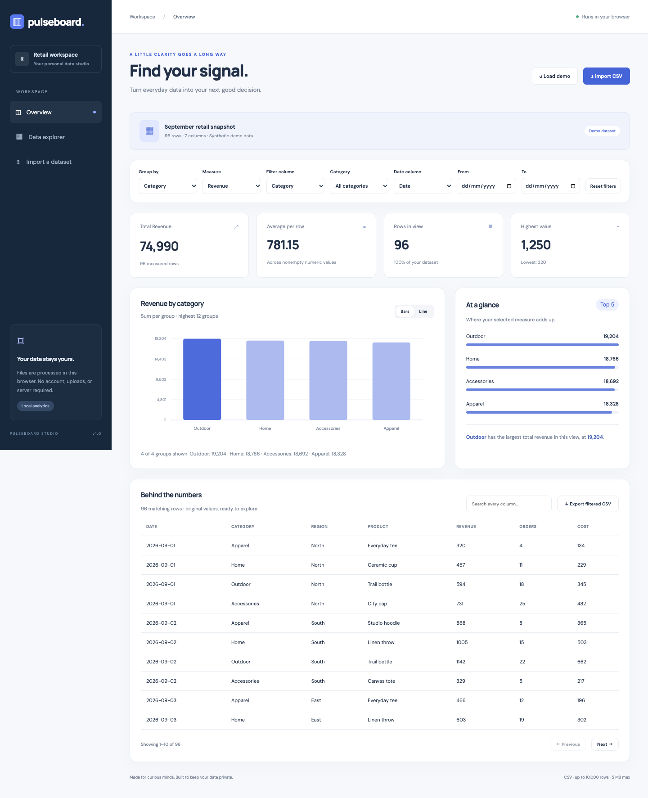

# Pulseboard

[Open live app](https://mohdriyaazpersonal.github.io/pulseboard/)



A private, responsive CSV analytics studio. Import data, choose dimensions and measures, combine filters, explore charts, and export the rows behind an insight.

## Run

Requires Node.js 22 or newer. No package installation is needed.

```sh
npm start
npm test
npm run build
```

Open the URL printed by the development server. `dist/` is a portable static site. Deploy its contents to a static host. JavaScript modules require HTTP rather than opening the HTML directly.

## Features

- CSV import with quoted commas, escaped quotes, embedded newlines, CRLF, and BOM support; clear validation for malformed files.
- Numeric measure selection; any column as a dimension; category, date, and full-text filters.
- SVG bar and line charts, accessible text summaries, top-group breakdown, and statistics.
- Paginated source table and formula-safe CSV export.
- Deterministic, clearly labeled synthetic retail demo data.
- Responsive layout, keyboard controls, semantic form labels, and reduced-motion support.

## Limits and privacy

All processing happens in your browser. Data is held in memory and disappears on reload. Imports allow 5 MB, 10,000 rows, and 40 columns. Dates must use `YYYY-MM-DD`; numbers must use plain decimal notation without currency symbols or separators. Blank numeric cells are excluded from averages and treated as zero in grouped sums. Bars show the largest 12 groups; lines show the first 30 groups sorted by label. Text summaries disclose the displayed subset. Numeric precision follows JavaScript floating-point arithmetic. The optional Google Fonts request downloads typography, with system font fallbacks.

## Inspiration

Built with Codex as an independent code implementation inspired by Handshake's [Turn data into an interactive dashboard](https://app.joinhandshake.com/learn/turn-data-into-an-interactive-dashboard-24427ee4). This repository does not claim completion of provider-specific mission steps or submission to Handshake.
